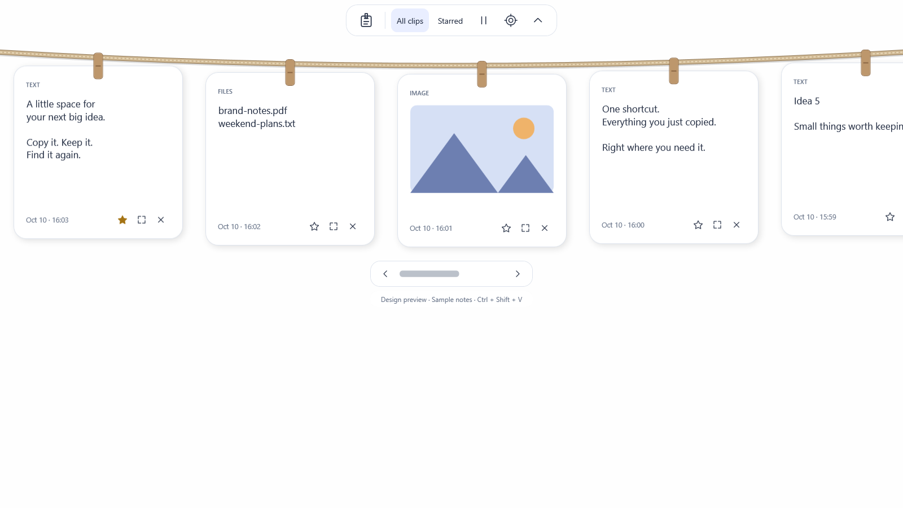

<p align="center"></p>

<p align="center">
  <a href="https://github.com/shardapps/clippboard/actions/workflows/ci.yml"></a>
  <a href="LICENSE"></a>
  
  
</p>

**A Windows clipboard companion with a little personality.** Press **Ctrl + Shift + V** and a rope drops from the top of your screen, carrying rounded paper notes for the things you copied. Pick a note to restore it and request a paste into your previous app. Click outside or press Escape to tuck it away.

Built by [Shard Apps](https://github.com/shardapps). Open source, local first, and designed to stay out of your way.

> **Early alpha:** the first working foundation is here. There is no stable release yet. Performance targets, broad app compatibility, installer validation, and accessibility testing are still in progress. Please use test data while evaluating it.

<p align="center"></p>

*Sample notes rendered by the app; an alpha design preview, not a capture of real clipboard history.*

### A line for your everyday things

| Clip | What the alpha remembers | What comes back |
| :--- | :--- | :--- |
| Text | Plain Unicode text | The original plain text |
| Images | Standard clipboard bitmap, encoded as PNG | A bitmap for image-aware destinations |
| Files & folders | Original paths, without duplicating files | A file-copy operation in destinations such as Explorer |

- **One shortcut, one click:** global shortcut and notification-area icon.
- **Paper, rope, and pegs:** soft colors, rounded notes, smooth entrance and retraction.
- **Pin what matters:** pinned notes survive expiry; delete individual notes or clear everything.
- **Local storage:** Windows DPAPI protects saved contents for your Windows user. No accounts, sync, telemetry, or application network service.
- **Bounded history:** 30 days for unpinned entries, 500 clips, and 256 MiB of encrypted payloads. New items are rejected if pins fill the budget.
- **Pause on demand:** use the rope or tray menu before copying something sensitive.

### Try the alpha

Windows 11 is the initial support target. Windows 10, ARM64, and mixed-DPI setups need further validation before being advertised as supported.

**Unsigned alpha binaries:** open a successful [Windows build](https://github.com/shardapps/clippboard/actions/workflows/ci.yml), download the `clippboard-windows-x64-alpha` artifact, and unzip it. Run `installer/Clippboard-Setup-0.1.0.exe` for a per-user installation, or `portable/win-x64/Clippboard.exe` directly. GitHub may require sign-in for artifact downloads; artifacts expire after 14 days. These are evaluation builds, not stable releases.

1. Clone this repository and open PowerShell in its folder.
2. Run `./scripts/bootstrap.ps1` to install a private .NET 10 SDK under `.tools/` and build.
3. Run `./scripts/dev.ps1 run` to start the development app.
4. Copy text, a screenshot, or a file. Press **Ctrl + Shift + V** and select its note.

Development runs store history under this repository's ignored `.data/` folder. Quit from the tray when finished. Startup at sign-in is disabled for development runs.

**Controls:** click a note to restore and request paste; **Shift + click** restores without requesting paste; **☆ / ★** pins or unpins; **×** deletes. Tab navigates buttons and Enter activates them. The alpha displays up to 40 notes, with pins first; browsing/searching older notes is on the roadmap.

For a self-contained executable, run `./scripts/dev.ps1 publish`. Output: `artifacts/portable/win-x64/Clippboard.exe`; recipients do not need .NET installed. Build the setup executable with `./scripts/package.ps1` after installing Inno Setup 6. CI produces portable and setup artifacts. These are unsigned testing builds. [Packaging details →](docs/development.md)

### Know what is saved

Capture begins when Clippboard is running. It cannot reconstruct things copied before it started or while paused. **Start at sign-in** is an opt-in tray setting in regular builds.

File notes reference originals: moved, deleted, disconnected, or inaccessible files cannot be restored. Files are restored as copies rather than repeating an old cut. Virtual attachments and proprietary app formats are not supported yet. HTML/RTF styling is not preserved.

Automatic pasting depends on the destination. Windows can block input into elevated apps; if focus restoration or input injection fails, the item remains on the clipboard for manual **Ctrl + V**. Apps can ignore a successful paste keystroke; Clippboard cannot verify acceptance.

Clipboard history can contain private data. The app respects supported exclusion markers but cannot recognize every secret. Pause capture when needed. DPAPI does not protect against software already running as you. [Privacy & storage →](docs/privacy.md)

### Build with us

```powershell
./scripts/dev.ps1 build    # Release build
./scripts/dev.ps1 test     # Storage invariants + Windows encryption
./scripts/dev.ps1 preview  # Sample rope, without accessing the clipboard
./scripts/dev.ps1 publish  # Self-contained Windows x64 executable
```

The stack is **C# / .NET 10 LTS / WPF / Win32**. Capture uses notifications rather than polling; only summaries stay in memory, and decoded thumbnails are released when the rope closes. Download size and resident memory will be measured rather than guessed.

```text
src/        Core storage and Windows application
tests/      Executable storage regression suite
assets/     Brand graphics and application icon
docs/       Architecture, privacy, roadmap, testing
scripts/    Local setup, build, preview, packaging
installer/  Per-user Windows installer source
.github/    CI, issue forms, PR template, dependency updates
```

Start with [CONTRIBUTING.md](CONTRIBUTING.md), [the architecture](docs/architecture.md), or [the roadmap](docs/roadmap.md). Report bugs through [Issues](https://github.com/shardapps/clippboard/issues/new/choose), and use [Discussions](https://github.com/shardapps/clippboard/discussions) for ideas. Follow our [Code of Conduct](CODE_OF_CONDUCT.md). Sensitive reports: [SECURITY.md](SECURITY.md).

### License

Apache License 2.0. See [LICENSE](LICENSE). Repository brand assets are also contributed under Apache 2.0. Contributions are welcome under the same license.
