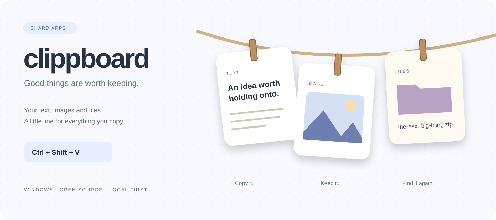
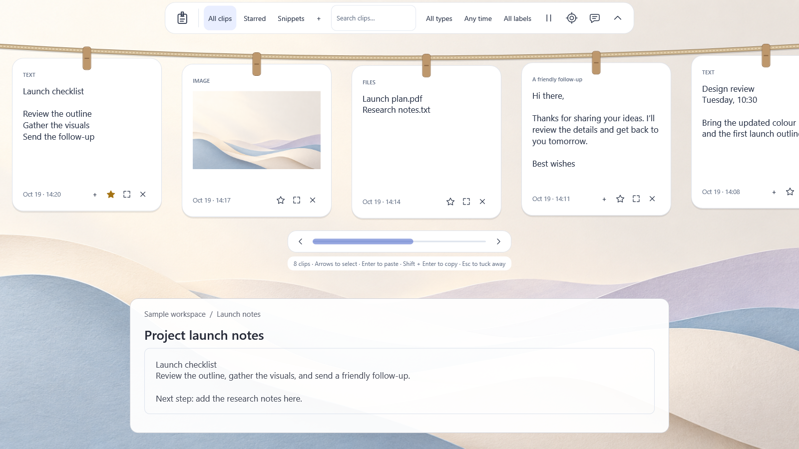
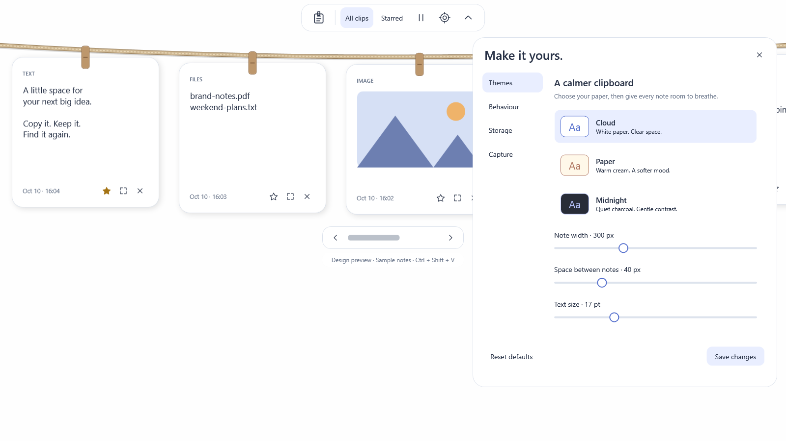

<p align="center"></p>

<p align="center">
  <a href="https://github.com/shardapps/clippboard/actions/workflows/ci.yml"></a>
  <a href="LICENSE"></a>
  
  
</p>

# Clippboard — Windows clipboard manager for text, images and files

**A Windows clipboard companion with a little personality.** Press **Ctrl + Shift + V** and a rope drops from the top of your screen, carrying rounded paper notes for the things you copied. Pick a note to restore it and request a paste into your previous app. Click outside or press Escape to tuck it away.

Built by [Shard Apps](https://github.com/shardapps). Open source, local first, and designed to stay out of your way.

> **Public beta 0.6.0-beta.5:** searchable history, snippets, OCR, encrypted backups and lower-memory Balanced rendering. [Download the beta](https://github.com/shardapps/clippboard/releases/tag/v0.6.0-beta.5). There is no stable release yet; physical-device, broad app compatibility and accessibility coverage remain in progress. The Store update requires separate certification and rollout.

<p align="center"></p>

*Actual beta views with sample clips and a staged workspace. The decorative wallpaper is AI-generated; the app UI is rendered from the code. [Store presentation and source assets](docs/marketing/store-0.6/README.md).*

### A line for your everyday things

| Clip | What the beta remembers | What comes back |
| :--- | :--- | :--- |
| Text | Unicode and bounded HTML/RTF | Original supported formats or plain text |
| Images | Standard clipboard bitmap, encoded as PNG | A bitmap for image-aware destinations |
| Files & folders | Original paths, without duplicating files | A file-copy operation in destinations such as Explorer |

- **One shortcut, one click:** global shortcut and notification-area icon.
- **Paper, rope, and pegs:** soft colors, rounded notes, smooth entrance and retraction.
- **Star what matters:** starred notes survive capacity eviction; every clip follows the chosen 1–30-day retention period.
- **Local storage:** Windows DPAPI protects saved contents for your Windows user. No accounts, sync, telemetry, or application network service.
- **Bounded history:** Configurable 1–30 days for all entries, 50–1,000 clips, and 32–512 MiB of encrypted payloads (defaults: 30 days / 500 / 256 MiB). New items are rejected if pins fill the budget.
- **Find and organize:** search full text and file paths with **Ctrl + F**; filter by type, date or stars; add labels and reusable snippets.
- **Work with clips:** preview text transformations, combine selected text, extract text with optional Windows OCR, and open original file locations or save images explicitly.
- **Keep a backup:** export password-encrypted backups and inspect a merge before restoring. Clipboard contents stay local; no cloud sync is added.
- **Balanced rendering:** cache viewport note pixels, reuse unchanged controls and adapt preview work to current memory headroom. Hardware and software compatibility modes remain available.
- **Make it yours:** Cloud (white), Paper, Midnight, Lavender, Ocean and Rose themes; live appearance previews commit only on Save. Adjust sizes, motion, shortcuts, capture types, starred ordering, retention, and storage/cache budgets.
- **Share feedback:** report bugs and suggest features from Help. You control what gets submitted; support information excludes clipboard contents and personal paths.
- **Pause on demand:** use the rope or tray menu before copying something sensitive.

### Try the beta

Windows 11 is the initial support target. Windows 10, ARM64, and mixed-DPI setups need further validation before being advertised as supported.

**Download 0.6.0-beta.5:** [per-user installer (.exe)](https://github.com/shardapps/clippboard/releases/download/v0.6.0-beta.5/Clippboard-Setup-0.6.0-beta.5.exe) · [portable ZIP](https://github.com/shardapps/clippboard/releases/download/v0.6.0-beta.5/Clippboard-Portable-0.6.0-beta.5-win-x64.zip) · [release notes, checksums and licences](https://github.com/shardapps/clippboard/releases/tag/v0.6.0-beta.5). Extract the complete portable ZIP and run `Clippboard.exe`, keeping the `licenses` folder, or use the per-user installer. No separate .NET installation is needed. These EXEs are **unsigned** and can show SmartScreen's unknown-publisher warning. [Previous 0.5.1 alpha](https://github.com/shardapps/clippboard/releases/tag/v0.5.1).

**Microsoft Store:** [install Clippboard from Microsoft Store](https://apps.microsoft.com/detail/9PP8015JDJ45), published on **October 13, 2026**, under **ShardCoders**. The approved package is **0.5.1.0**, Windows 11 x64; its public listing and official Download / View in Store controls are verified, including the Pakistan catalog. Use the Store distribution for the Microsoft trust path. Store-signed installed behavior remains a separate test; Store signing does not sign the GitHub EXEs. [Store distribution](docs/store.md) · [Release validation checklist](docs/release-checklist.md) · [Changelog](CHANGELOG.md)

1. Clone this repository and open PowerShell in its folder.
2. Run `./scripts/bootstrap.ps1` to install a private .NET 10 SDK (10.0.402 or newer) under `.tools/` and build.
3. Run `./scripts/dev.ps1 run` to start the development app.
4. Copy text, a screenshot, or a file. Press **Ctrl + Shift + V** and select its note.

Development runs store history under this repository's ignored `.data/` folder. Quit from the tray when finished. Startup at sign-in is disabled for development runs.

**Controls:** click a note to restore and request paste; **Shift + click** restores without requesting paste; **☆ / ★** pins or unpins; **×** deletes. Tab navigates buttons and Enter activates them. Use the mouse wheel, arrow keys, or custom navigation strip to browse all saved notes. **Expand** opens full content in a resizable panel. **All clips / Starred** filters the list. The logo or gear opens settings.

Search includes full text and file paths using bounded background work. Use type/date/label filters, Starred and Snippets to narrow the list. Use the speech-bubble button for Help and feedback. Appearance changes preview live; closing without Save restores your saved appearance. A saved rendering-mode change applies after reopening the rope.

For a self-contained executable, run `./scripts/dev.ps1 publish`. Output: `artifacts/portable/win-x64/Clippboard.exe`; recipients do not need .NET installed. Build the setup executable with `./scripts/package.ps1` after installing Inno Setup 6. CI produces portable and setup artifacts. These are unsigned testing builds. [Packaging details →](docs/development.md) · [Dependency and notice review](docs/dependency-audit.md)

<details><summary>Settings and themes preview</summary>



</details>

### Know what is saved

Capture begins when Clippboard is running. It cannot reconstruct things copied before it started or while paused. **Start at sign-in** is opt-in through settings or the tray in regular EXE builds. Store installations expose the opt-in startup task in Windows Settings → Apps → Startup after first launch.

File notes reference originals: moved, deleted, disconnected, or inaccessible files cannot be restored. Files are restored as copies rather than repeating an old cut. Virtual attachments and proprietary app formats are not supported yet. Bounded HTML/RTF is preserved when supported; previews remain inert and destinations may fall back to plain text.

Automatic pasting depends on the destination. Windows can block input into elevated apps; if focus restoration or input injection fails, the item remains on the clipboard for manual **Ctrl + V**. Apps can ignore a successful paste keystroke; Clippboard cannot verify acceptance.

Clipboard history can contain private data. The app respects supported exclusion markers but cannot recognize every secret. Pause capture when needed. DPAPI does not protect against software already running as you. [Privacy policy →](https://shardapps.github.io/clippboard/privacy/) · [Technical storage details →](docs/privacy.md)

### Frequently asked questions

**What is Clippboard?** An Apache-2.0 open-source clipboard history manager for Windows 11, built with C#, .NET 10, WPF and Win32. Text, standard bitmap images and original file locations appear as paper notes on a full-width rope.

**Does it sync my clipboard or require an account?** No. Clipboard storage stays encrypted on your PC using Windows DPAPI. Feedback links open GitHub in your browser only when requested; GitHub may require an account to submit feedback.

**Can I keep everything forever?** No. Choose 1–30 days, including starred notes, plus count and storage limits. Starred notes survive capacity eviction but still expire. File notes refer to originals, so deleted or moved originals must be copied again.

**Can I use it instead of Windows clipboard history?** It is a separate experimental app with image/file notes, themes, search and a different interface. Compatibility, accessibility and memory testing remain in progress; it does not replace or configure Windows clipboard history.

**Is there a stable, signed installer?** There is no stable release yet. GitHub's 0.5.1 alpha installer remains unsigned. The certified Store distribution is live under ShardCoders and uses Microsoft's trust path; installed behavior is still being tested. [Signing setup and SmartScreen explanation](docs/signing.md). See the alpha limitations above and [validation record](docs/testing.md).

### Build with us

The source is being prepared as **0.6.0-beta.5** (validation candidate): encrypted card-sized image previews, full-text/file-path search, date filters, keyboard navigation, app exclusions, timed pause, recoverable clear-on-lock, previewed text actions/snippets, text combinations and bounded source formatting are being tested through focused PRs. [On-demand local OCR](docs/local-ocr.md) for the Store package and [password-encrypted portable backups](docs/backups.md) and [reviewable support diagnostics](docs/diagnostics.md) are also in development. These changes are not in the published 0.5.1 downloads. Follow the [beta checklist](docs/beta-checklist.md), [retrieval guide](docs/retrieval.md) and [text-reuse guide](docs/text-reuse.md) for implementation and validation status.

```powershell
./scripts/dev.ps1 build    # Release build
./scripts/dev.ps1 test     # Storage invariants + Windows encryption
./scripts/dev.ps1 preview  # Sample rope, without accessing the clipboard
./scripts/dev.ps1 publish  # Self-contained Windows x64 executable
```

The stack is **C# / .NET 10 LTS / WPF / Win32**. Capture uses notifications rather than polling; only summaries stay in memory, and decoded thumbnails are released when the rope closes. The image cache is bounded and clears on hide; payloads load on demand from encrypted storage. [Measured limits and remaining validation](docs/testing.md) are documented; runtime performance is still an alpha work item.

```text
src/        Core storage and Windows application
tests/      Executable storage, format, cache, and WPF regression suite
assets/     Brand graphics and application icon
docs/       Architecture, privacy, roadmap, testing
scripts/    Local setup, build, preview, packaging
installer/  Per-user Windows installer source
.github/    CI, issue forms, PR template, dependency updates
```

Start with [CONTRIBUTING.md](CONTRIBUTING.md), [the architecture](docs/architecture.md), or [the roadmap](docs/roadmap.md). Report bugs through [Issues](https://github.com/shardapps/clippboard/issues/new/choose), and use [Discussions](https://github.com/shardapps/clippboard/discussions) for ideas. Follow our [Code of Conduct](CODE_OF_CONDUCT.md). Sensitive reports: [SECURITY.md](SECURITY.md).

### License

Apache License 2.0. See [LICENSE](LICENSE). Repository brand assets are also contributed under Apache 2.0. Contributions are welcome under the same license.
