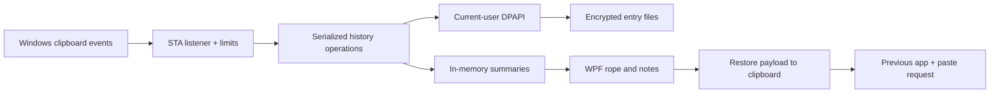

# Architecture

C# / .NET 10 LTS / WPF / Win32 gives direct Windows integration, vector UI, and animations without an embedded browser. Self-contained builds bundle .NET, increasing download size. WPF trimming/NativeAOT are not enabled. The app uses framework APIs without third-party runtime dependencies.

`Clippboard.Core` owns format models, deduplication, retention, capacity, and atomic encrypted writes behind an encryption interface. `Clippboard.App/Platform` owns DPAPI, interop, foreground tracking, and input synthesis. `Services` owns STA capture/retry/restore. `Views` owns notes/animation, and `App` owns lifecycle, tray, startup, and orchestration.

## Resources

Capture is event-driven, with an 80 ms retry timer only during clipboard contention (eight attempts maximum). Rapid clipboard changes may supersede intermediate copies; capture is not lossless. Store operations are serialized and run off the UI thread where practical. Only summaries are retained. At most 40 images are decoded at 300 pixels wide; hiding releases them.

Capture limits bound retained resources but cannot control Windows clipboard conversion allocations or another app's delayed rendering. Network-path existence checks can be slow. Stricter timeouts/isolation are planned before stable release.

The overlay uses physical monitor work-area coordinates. Mixed DPI, negative origins, remote sessions, small screens, and taskbar positions require validation. The first outside click dismisses and is consumed.

## Paste policy

Restore, retract, return focus, wait for modifiers to release, verify foreground, then send Ctrl+V. Denied focus/input leaves the item available for manual paste. Shift+click restores only. File references are checked and restored with copy effect. Destination acceptance cannot be reliably confirmed.
