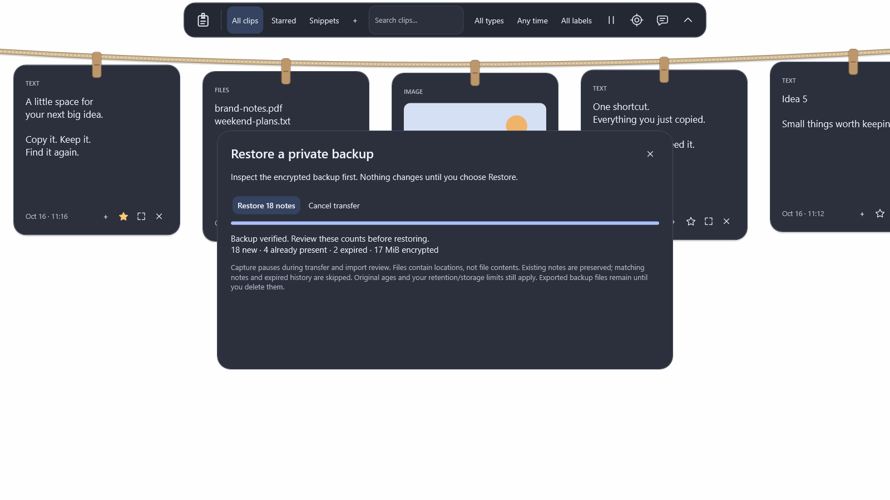

# Private backups in the next beta

Published 0.5.1 does not include this feature. In development builds, open **Settings → Storage → Encrypted backup…** or **Restore backup…**.

Export creates a `.clippboard` file in the location you choose. Enter and confirm a strong 12–256-character passphrase; there is no password recovery. The app encrypts records incrementally, rereads and verifies the complete encrypted file, then replaces the selected destination. A changed or locked destination is preserved. Export status contains counts, not clipboard text, passwords or paths.

Import first verifies the password and entire archive and prepares encrypted local staging. Review the counts of new, matching and expired notes, then explicitly choose **Restore**. It never overwrites an existing note or evicts history to fit an import. Source ID conflicts become separate copies. File notes contain their original locations, not independent copies of those files. Timestamps and stars survive transfer; notes still expire using their original ages and your current 1–30-day retention setting, including stars.

Capture pauses during export, inspection and import review, and resumes after the transfer finishes or cancellation cleanup completes, subject to your saved pause/privacy settings. Copies made while paused are not reconstructed later. Only one transfer can run at a time. Closing the panel/rope or locking Windows cancels pending work. Cancellation cannot undo an export replacement or restore that already crossed its commit point. A stalled filesystem operation can keep the single worker busy until Windows returns; retries cannot create additional workers.

Password fields clear after starting, and owned password/encoding buffers are wiped. Passwords are not written into settings, status messages or diagnostics. The encrypted backup file is independent of normal history retention: **it remains until you delete it**. A cloud-synced or shared destination may copy it according to that folder provider's settings; Clippboard does not upload it itself.

Import staging is DPAPI-encrypted under the app's history directory. Completed/canceled jobs remove it where filesystem access permits, and startup retries abandoned staging cleanup. Interrupted restores have journal recovery. Export uses encrypted `.clippboard-backup-<random>.tmp` staging beside the chosen destination; normal success/failure/cancellation removes it. A process/power failure or lost access can leave that encrypted temporary file, which can be removed manually. No plaintext archive is assembled or written.

See the [format and recovery specification](portable-backup-format.md) for limits and cryptography. Filesystem job checks and WPF interaction tests use synthetic data. Store-installed transfers, real disk-full cases and remote-folder behavior remain beta acceptance gates.

Reproduce this synthetic screen with `./scripts/dev.ps1 -Task preview -Backup -Theme Midnight`; it does not read personal clipboard history.
