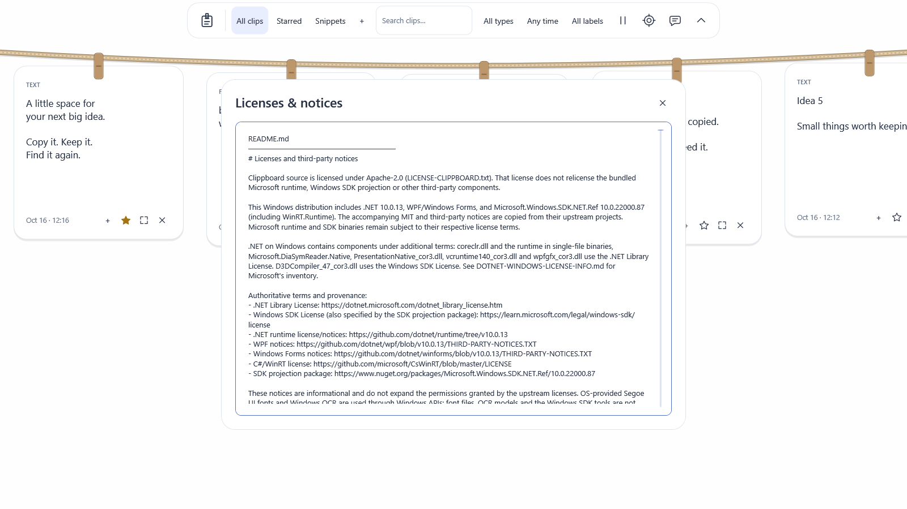

# Dependency and distribution review — next beta

Reviewed October 16, 2026. Published 0.5.1 assets have not been replaced.

## Servicing and package graph

The development toolchain floor is .NET SDK **10.0.402**, which carries **10.0.13**. Microsoft's October 13 servicing metadata identifies that release as a security update. The local SDK archive was downloaded from the official release metadata and verified against its published SHA-512 before extraction. CI continues to select current stable 10.0.x, and global.json permits newer feature/patch servicing within .NET 10. Self-contained applications require republishing to update their included runtime; updating a user's global .NET installation does not update an existing standalone bundle.

Windows SDK projection **10.0.22000.87** is pinned centrally, replacing 10.0.22000.57. The target/minimum OS stays Windows 11 build 22000; this does not add Windows 10 or ARM64 support. The app uses WPF, Windows Forms tray integration, the platform projection and OS-provided OCR. There are no separate UI frameworks, browser runtimes, OCR model downloads or application third-party PackageReference entries.

NuGet is configured to use the official nuget.org package/audit source, with locked restore and all-dependency auditing enabled. `./scripts/audit-dependencies.ps1` fails on an incomplete/failed query or reported vulnerable direct/transitive graph entries and records a repository-relative report in ignored artifacts. A query reporting no vulnerable graph entries is **not** a complete security audit: SDK/framework download packs and bundled runtime/native binaries need their own servicing/provenance review. Re-run near release; advisories change.

## Distribution notices

The installer previously included only the project's Apache-2.0 license. Notices for the .NET runtime, WPF, Windows Forms and C#/WinRT are now committed from upstream, embedded for offline viewing under **Settings → Help → Licenses & notices**, and copied into portable/installer/Store layouts. Verification compares distributed notice bytes with the source copies; missing/altered-file failure checks run in CI. A standalone single-file EXE still contains the embedded notices.

.NET on Windows includes binaries under the .NET Library License and Windows SDK License in addition to MIT components. The inventory and authoritative links are in [the bundled notice guide](../assets/licenses/README.md); Clippboard's Apache-2.0 source license does not relicense those components. Windows fonts, OCR language models and SDK tools are not shipped by this app. Signing identity/reputation remains separate from licenses and checksums.

## Scope and limits

The review covers declared/downloaded platform dependencies, current servicing, distribution notices and the repository's locked build path. It is not an independent penetration test or legal opinion. Store-installed feature checks, broader device/accessibility tests and the remaining beta gates still apply.

Primary sources: [Microsoft servicing metadata](https://builds.dotnet.microsoft.com/dotnet/release-metadata/10.0/releases.json), [.NET support and self-contained servicing policy](https://dotnet.microsoft.com/platform/support/policy/dotnet-core), [NuGet auditing](https://learn.microsoft.com/nuget/concepts/auditing-packages), [SDK projection package](https://www.nuget.org/packages/Microsoft.Windows.SDK.NET.Ref/10.0.22000.87), and [Microsoft's Windows binary license inventory](https://github.com/dotnet/core/blob/main/license-information-windows.md).

Synthetic preview: `./scripts/dev.ps1 -Task preview -Notices -Theme Cloud`.
