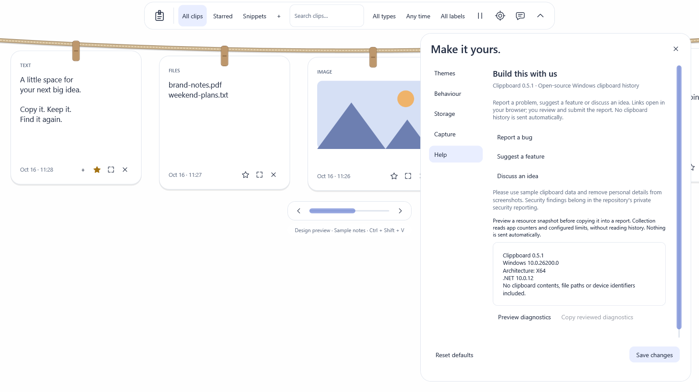

# Support diagnostics in the next beta

Published 0.5.1 does not include this resource preview. In development builds, open **Settings → Help → Preview diagnostics**. Collection reads counters for the listener and its own overlay/prepared process, along with configured limits and a few behavior switches. It does not decrypt or enumerate history payloads.

Review the text, then choose **Copy reviewed diagnostics** if useful. Copying uses the listener's clipboard restoration path so the app does not immediately capture its own support text as a new history item. The rope stays open. The public bug/feature links open your browser; you decide what to paste and submit. Nothing is uploaded automatically.

The report excludes clipboard contents, note titles, labels, file paths, excluded application names, process IDs, account identifiers and passwords. It includes app/runtime/Windows version, architecture, package identity availability, private bytes, working sets, handles, configured storage/preview limits, pause state and rendering preferences.

This is a momentary resource snapshot, not proof of a memory leak or an opening-latency measurement. Combined private bytes include the listener and child. Working sets can share pages and should not be summed as a RAM estimate. A process that has exited or cannot be queried is marked unavailable, not zero. Closing Help discards late collection replies.

Use synthetic clipboard examples and redact screenshots before reporting. Security findings belong in the repository's private security reporting route.

Synthetic preview: `./scripts/dev.ps1 -Task preview -Help -Theme Cloud`.

Diagnostics are a Help action; Save changes applies preferences and is not required to collect or copy the preview.
