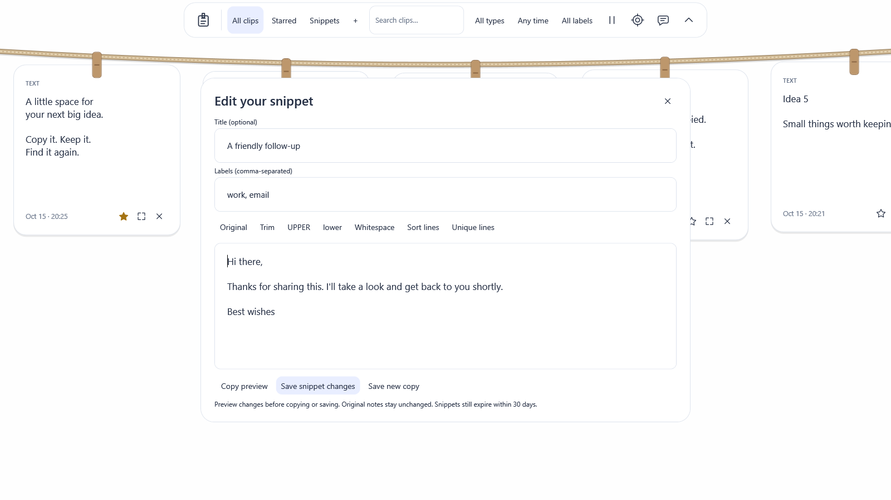

# Text reuse in the next beta source

These changes follow the published 0.5.1 alpha and are not in its download assets.

Expand a text note and choose **Edit a copy**. The editor supports trim, invariant upper/lowercase, whitespace collapse, line sorting and case-sensitive duplicate-line removal. Review and edit the result before choosing **Copy preview**. **Original** restores the input exactly, including line endings. Transformations do not overwrite captured notes. Background transformations are serialized and obsolete results are canceled, including when you type during processing or close the editor.

**Save as snippet** creates an independently identified, encrypted text entry. The + button creates a new snippet directly. Titles are optional (64 characters); up to eight comma-separated labels can contain 24 characters each. Labels and titles are searchable, and the label button cycles available labels. **Snippets**, **Starred**, type, date and label filters can be combined; **All clips** clears the starred/snippet subset.

New snippets are starred by default. Existing snippets can be edited or saved as a new copy; ordinary clipboard notes cannot be overwritten through snippet editing. Changes preserve the original creation time and pin state. Snippets obey the same 1–30-day expiry and entry/storage limits as other history, including stars. Editing never renews that clock. A deleted or expired snippet requires an explicit new-copy save rather than silently reappearing. Capacity/entry-size rejection leaves the prior snippet intact.

The maximum editable text length remains 524,288 UTF-16 code units. Unicode text is bounded in private-pipe framing as well as at the listener's command boundary. Text edits are temporary until explicitly copied or saved; no plaintext editor files or network service are introduced.

Reproduce this synthetic preview without accessing the system clipboard using `./scripts/dev.ps1 preview -Snippet`. The snapshot is development UI, not the published alpha or real clipboard content.
